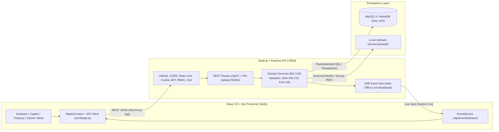
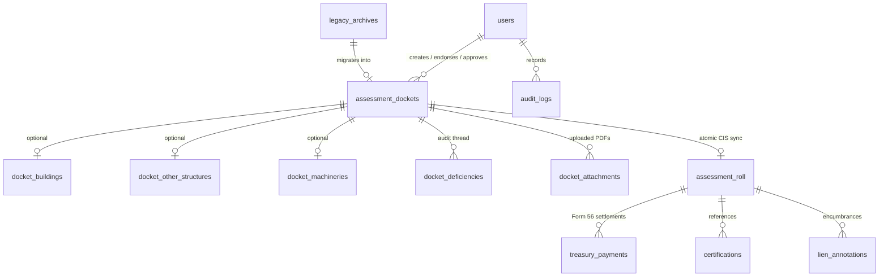

# RPAT-IOSS Backend Implementation Plan (Node.js + Express + MySQL)

> **Status:** Planned for future execution (no backend code written yet)  
> **Target Stack:** Node.js v22 + Express 5 + TypeScript + MySQL (`mysql2/promise`)

---

## 1. Goal & Scope

Replace the current in-memory React state (`src/context/RpatisContext.tsx` + `src/data/mockData.ts`) in **RPAT-IOSS** with a persistent, secure, transactional **Node.js + Express + TypeScript + MySQL** backend (`server/`).

This backend will:
- Persist all **FAAS declarations** (**Land, Buildings, Other Permanent Structures, and Machinery**), Assessment Roll rows, Capitol reviews & SHA-256 CIS seals, Treasury Form 56 payments & Tax Clearances, Historical Cadastre Vault ledgers, and all 11 Assessor frontline services in **MySQL**.
- Enforce real authentication (`bcryptjs` + `HttpOnly` JWT cookies) and strict **RBAC** (`assessor_clerk`, `assessor_chief`, `capitol_examiner`, `capitol_approver`, `treasury_cashier`) plus a real **15-minute inactivity timeout**.
- Enforce **server-side statutory math** under **RA 7160** (Sec. 218 assessment levels, Sec. 225 machinery `20%` residual value floor / `80%` max depreciation, Sec. 255 delinquent interest) and **RA 10173** privacy masking on public tracking endpoints.
- Provide **<1s cross-office & cross-tab sync** via **Server-Sent Events (SSE)** backed by atomic MySQL transactions.
- Resolve all **8 functional bugs/gaps** identified during the QA audit:
  1. Capitol CIS-to-Treasury auto-sync React state race condition (`approveAndIssueCis` atomic DB transaction).
  2. Unpersisted PIN / ARP reservations (`pin_reservations` table with `UNIQUE` collision guard).
  3. Discarded Capitol Examiner audit notes & compliance checklist state (persisted on `assessment_dockets`).
  4. Unpaid Tax Clearance page access returning `"FULLY PAID"` (`GET /api/treasury/clearance/:tdNo` returns `409 Conflict` if unpaid + frontend guard).
  5. Hardcoded `candidateClearance` (`TC-PAS-2026-0419`) in Cashier Window #3 replaced with unique sequential server serials.
  6. Unenforced Clerk vs. Chief and Examiner vs. Approver permissions replaced with server RBAC middleware + UI role gates.
  7. Hardcoded problem resolution remarks in `ViewProblemResolution` replaced with an editable resolution note field.
  8. Fixed `4%` delinquent interest mode in Treasury Billing replaced with configurable delinquent months (`1–36` months at `2%/mo`, capped at `72%` under RA 7160 Sec. 255).

---

## 2. System Architecture



---

## 3. Necessary Dependencies

### Backend Production Dependencies (`server/package.json`)

| Package | Version | Purpose |
| :--- | :--- | :--- |
| `express` | `^5.1.0` | HTTP server, routing, middleware pipeline |
| `mysql2` | `^3.14.0` | High-performance MySQL/MariaDB driver with `mysql2/promise` connection pool & prepared statements |
| `dotenv` | `^16.5.0` | Environment variable management (`server/.env`) |
| `cors` | `^2.8.5` | Strict origin allow-list for Vite dev (`localhost:8443`) & production domain |
| `helmet` | `^8.1.0` | Security HTTP headers (XSS, clickjacking, MIME sniffing protection) |
| `express-rate-limit` | `^7.5.0` | Brute-force & abuse protection on `/api/auth/login` and `/api/public/track` |
| `bcryptjs` | `^3.0.2` | Pure-JS password hashing (12 salt rounds; avoids Windows native C++ build issues) |
| `jsonwebtoken` | `^9.0.2` | Signed JWT access tokens stored in `HttpOnly`, `SameSite=Lax` cookies |
| `cookie-parser` | `^1.4.7` | Parses `HttpOnly` auth cookies on incoming requests |
| `zod` | `^3.24.2` | Runtime request body/query/params schema validation with typed 400 errors |
| `multer` | `^1.4.5-lts.2` | Multipart file uploads for Deeds, BIR eCAR, Geodetic Surveys, and Legacy Scans (PDF/JPG/PNG, max 10 MB) |
| `morgan` | `^1.10.0` | Structured HTTP request logging |
| `uuid` | `^11.1.0` | Collision-safe internal IDs and disk upload filenames |

### Backend Dev & Root Orchestration Dependencies

| Package | Location | Purpose |
| :--- | :--- | :--- |
| `typescript`, `tsx` | `server/devDependencies` | TypeScript compilation & instant hot-reload (`tsx watch src/index.ts`) |
| `@types/express`, `@types/cors`, `@types/cookie-parser`, `@types/bcryptjs`, `@types/jsonwebtoken`, `@types/multer`, `@types/morgan`, `@types/node` | `server/devDependencies` | Complete TypeScript definitions |
| `vitest`, `supertest`, `@types/supertest` | `server/devDependencies` | Automated REST API, RBAC, and transaction integration tests |
| `concurrently` | Root `package.json` (`devDependencies`) | Single command `npm run dev:all` to launch Vite (`:8443`) + Express (`:4000`) together |

---

## 4. MySQL Database Schema (`rpat_ioss`)

All monetary columns use `DECIMAL(14,2)` (never `FLOAT`/`DOUBLE`) to prevent rounding drift in statutory RA 7160 calculations. All tables use `ENGINE=InnoDB DEFAULT CHARSET=utf8mb4 COLLATE=utf8mb4_unicode_ci`.



### 17 Normalized Tables (`server/sql/001_schema.sql`)

1. **`users`** — `id` (PK), `employee_id` (`UNIQUE`), `password_hash`, `role` (`ENUM('assessor_clerk','assessor_chief','capitol_examiner','capitol_approver','treasury_cashier')`), `full_name`, `title`, `department`, `department_name`, `office_location`, `email` (`UNIQUE`), `avatar_initials`, `permissions_json`, `is_active`, `last_login_at`, `created_at`.
2. **`smv_rates`** — Camarines Sur Provincial Ordinance 2024-08 rates (`id`, `category`, `subclass` `UNIQUE`, `description`, `zones`, `unit_value` `DECIMAL(12,2)`, `assessment_level` `TINYINT UNSIGNED`, `ordinance_ref`, `is_active`).
3. **`assessment_dockets`** — `id` (`VARCHAR(32) PK`, e.g., `PAS-2026-0849`), `capitol_id` (`UNIQUE`), `td_no`, `pin`, `lgu`, `barangay`, `lot_no`, `owner`, `owner_masked`, `contact`, `transaction_type` (`ENUM`), `classification` (`ENUM`), `smv_subclass`, `area_sqm` `DECIMAL(12,2)`, `unit_value` `DECIMAL(12,2)`, `assessment_level` `TINYINT UNSIGNED`, `land_market_value` `DECIMAL(14,2)`, `land_assessed_value` `DECIMAL(14,2)`, `market_value` `DECIMAL(14,2)`, `assessed_value` `DECIMAL(14,2)`, `status` (`ENUM('Draft','Needs Signature','At Capitol','Under Technical Review','Flagged','Approved','Paid')`), `verified_docs_json`, `examiner_checklist_json`, `examiner_notes`, `examiner_name`, `cis_serial` (`UNIQUE NULL`), `cis_hash` (`CHAR(64) NULL`), `or_no`, `tax_clearance_no`, `amount_paid` `DECIMAL(14,2)`, `created_by`, `endorsed_by`, `approved_by`, `submitted_at`, `transmitted_at`, `approved_at`, `paid_at`, `updated_at`.
4. **`docket_buildings`** — `docket_id` (`PK/FK ON DELETE CASCADE`), `structural_type`, `floor_area_sqm` `DECIMAL(10,2)`, `year_built` `SMALLINT`, `depreciation_percent` `DECIMAL(5,2)`, `unit_cost_per_sqm` `DECIMAL(12,2)`, `market_value` `DECIMAL(14,2)`, `assessed_value` `DECIMAL(14,2)`.
5. **`docket_other_structures`** — `docket_id` (`PK/FK ON DELETE CASCADE`), `structure_type`, `description`, `area_or_units` `DECIMAL(10,2)`, `year_built` `SMALLINT`, `replacement_cost` `DECIMAL(14,2)`, `depreciation_percent` `DECIMAL(5,2)`, `assessment_level` `TINYINT UNSIGNED`, `market_value` `DECIMAL(14,2)`, `assessed_value` `DECIMAL(14,2)`.
6. **`docket_machineries`** — `docket_id` (`PK/FK ON DELETE CASCADE`), `description`, `brand_model`, `machinery_class` (`ENUM('Agricultural','Residential','Commercial / Industrial')`), `acquisition_cost` `DECIMAL(14,2)`, `year_acquired` `SMALLINT`, `depreciation_percent` `DECIMAL(5,2)` (`CHECK <= 80`), `assessment_level` `TINYINT UNSIGNED`, `market_value` `DECIMAL(14,2)`, `assessed_value` `DECIMAL(14,2)`.
7. **`docket_deficiencies`** — `id` (`PK`), `docket_id` (`FK ON DELETE CASCADE`), `author_id` (`FK NULL`), `author_name`, `author_role`, `message` (`TEXT`), `is_corrective_resubmission` (`BOOLEAN`), `resolved` (`BOOLEAN`), `created_at`.
8. **`docket_attachments`** — `id` (`CHAR(36) PK`), `docket_id` (`FK ON DELETE CASCADE`), `doc_category` (`ENUM('survey','deed','ecar','faas','corrective','other')`), `original_filename`, `stored_filename`, `mime_type`, `size_bytes`, `uploaded_by` (`FK`), `uploaded_at`.
9. **`assessment_roll`** — `td_no` (`VARCHAR(32) PK`), `pin` (`VARCHAR(40) UNIQUE`), `docket_id` (`FK NULL`), `owner_masked`, `owner_full`, `barangay`, `classification`, `area_sqm`, `unit_value`, `market_value`, `assessment_level` `DECIMAL(4,2)`, `assessed_value`, `basic_rpt`, `sef`, `total_tax_due`, `payment_status` (`ENUM('Paid','Unpaid','Partial')`), `latest_or_no`, `source` (`ENUM('Capitol CIS Approved','Assessor Roll')`), `synced_at`.
10. **`treasury_payments`** — `id` (`BIGINT AUTO_INCREMENT PK`), `td_no` (`FK`), `docket_id` (`FK NULL`), `or_no` (`UNIQUE`), `clearance_no` (`UNIQUE`), `payor_name`, `payment_method` (`ENUM('Cash','LandBank','Check')`), `billing_period` (`ENUM('Q1','Regular','Delinquent')`), `delinquent_months` (`TINYINT UNSIGNED DEFAULT 0`), `basic_rpt`, `sef`, `adjustment_amount`, `net_amount_paid`, `tendered_amount`, `change_due`, `cashier_id` (`FK`), `paid_at`.
11. **`certifications`** — `id` (`PK`), `cert_type`, `td_no`, `pin`, `requestor_name`, `purpose`, `proof_of_ownership_verified`, `spa_verified`, `treasury_or_no`, `fee_amount`, `status`, `issued_by` (`FK`), `issued_at`.
12. **`lien_annotations`** — `id` (`PK`), `action`, `td_no` (`FK`), `pin`, `owner_name`, `mortgagee_bank`, `notice_ref_no`, `annotation_or_no`, `status`, `recorded_by` (`FK`), `recorded_at`.
13. **`pin_reservations`** — `id` (`BIGINT AUTO_INCREMENT PK`), `pin` (`UNIQUE`), `arp_no` (`UNIQUE`), `barangay_code`, `section_code`, `parcel_code`, `reserved_by` (`FK`), `reserved_at`, `consumed_by_docket_id` (`NULL`).
14. **`ocular_inspections`** — `id` (`PK`), `requestor_name`, `lot_description`, `barangay`, `legal_doc_ref`, `scheduled_date` (`DATE`), `assigned_officer`, `status`, `verified_by` (`FK NULL`), `verified_at` (`NULL`).
15. **`problem_tickets`** — `id` (`PK`), `reference_no`, `category`, `client_name`, `description`, `resolution_notes` (`TEXT NULL`), `status` (`ENUM('Open','Resolved')`), `logged_by` (`FK`), `resolved_by` (`FK NULL`), `logged_at`, `resolved_at` (`NULL`).
16. **`legacy_archives`** — `id` (`PK`), `vintage_td` (`UNIQUE`), `revision`, `owner`, `lot`, `area`, `location`, `transcription` (`TEXT`), `scan_filename` (`NULL`), `migrated_docket_id` (`FK NULL`), `created_by` (`FK`), `created_at`.
17. **`audit_logs`** — Append-only COA / RA 10173 trail (`id` `BIGINT AUTO_INCREMENT PK`, `actor_id` `FK NULL`, `actor_role`, `action`, `entity_type`, `entity_id`, `metadata_json`, `ip_address`, `created_at`).

---

## 5. Folder Structure & Environment

### Backend Directory (`server/`)

```text
server/
├── package.json
├── tsconfig.json
├── .env.example
├── sql/
│   └── 001_schema.sql
├── uploads/                 # gitignored uploaded PDFs/scans
├── src/
│   ├── index.ts             # Express bootstrap, Helmet, CORS, routes, error handler
│   ├── config/env.ts        # Zod-validated environment loader
│   ├── db/
│   │   ├── pool.ts          # mysql2/promise pool + withTransaction()
│   │   ├── migrate.ts       # Creates DB & applies 001_schema.sql
│   │   └── seed.ts          # Idempotent seed of users, SMV, roll, dockets, archives
│   ├── middleware/
│   │   ├── auth.ts          # JWT HttpOnly cookie verification + 15m rolling idle check + requireRole()
│   │   ├── validate.ts      # Zod validation middleware
│   │   └── upload.ts        # Multer PDF/JPG/PNG uploader (10 MB cap)
│   ├── services/
│   │   ├── valuation.ts     # Authoritative RA 7160 valuation + real crypto SHA-256 CIS digest
│   │   ├── sseHub.ts        # Live Server-Sent Events broadcast hub
│   │   └── audit.ts         # Append-only audit_logs writer
│   └── routes/
│       ├── auth.ts
│       ├── dockets.ts
│       ├── capitol.ts
│       ├── treasury.ts
│       ├── frontline.ts
│       ├── legacy.ts
│       ├── smv.ts
│       ├── public.ts
│       └── events.ts
└── tests/
    └── api.integration.test.ts
```

### Example `server/.env.example`

```env
PORT=4000
NODE_ENV=development
FRONTEND_ORIGIN=http://localhost:8443

DB_HOST=127.0.0.1
DB_PORT=3306
DB_USER=root
DB_PASSWORD=
DB_NAME=rpat_ioss

JWT_SECRET=change-this-to-a-64-char-random-secret
SESSION_IDLE_MINUTES=15
UPLOAD_DIR=./uploads
```

---

## 6. REST API + Live Sync Contract

| Module | Endpoints | Allowed Roles | Key Behavior |
| :--- | :--- | :--- | :--- |
| **Auth** | `POST /api/auth/login`, `POST /api/auth/logout`, `GET /api/auth/me`, `POST /api/auth/dev-switch` *(dev only)* | Public / Authenticated | `bcryptjs` verify, `HttpOnly` JWT cookie, sliding 15-minute idle expiration |
| **FAAS & Dockets** | `GET /api/dockets`, `GET /api/dockets/:id`, `POST /api/dockets`, `PUT /api/dockets/:id`, `POST /api/dockets/endorse`, `POST /api/dockets/:id/resubmit`, `POST /api/dockets/:id/attachments`, `GET /api/dockets/:id/attachments/:attId` | Draft/Edit/Resubmit: `assessor_clerk`, `assessor_chief`<br>Endorse to Pili: `assessor_chief` | Server recomputes all 4 property kinds atomically; stores real uploaded PDFs/images |
| **Capitol Review** | `PUT /api/capitol/dockets/:id/inspection`, `POST /api/capitol/dockets/:id/flag`, `POST /api/capitol/dockets/:id/approve-cis` | Inspect/Flag: `capitol_examiner`, `capitol_approver`<br>CIS Sign-Off: `capitol_approver` only | Persists 4 statutory checks + `examinerNotes`; **atomic MySQL transaction** issues real 64-char SHA-256 CIS seal & upserts `assessment_roll` (eliminates race bug) |
| **Treasury** | `GET /api/treasury/roll`, `POST /api/treasury/billing/preview`, `POST /api/treasury/payments`, `GET /api/treasury/clearance/:tdNo` | `treasury_cashier` (Read roll also allowed for Assessor) | Supports `TD-26-0080` fuzzy recovery & custom delinquent months (`1–36`); generates unique `OR-2026-XXXXXX` & `TC-PAS-2026-XXXX`; **returns `409` if unpaid** |
| **Frontline Services** | `GET/POST /api/certifications`, `GET/POST /api/liens`, `POST /api/validation/td`, `GET/POST /api/pins/reservations`, `GET/POST /api/ocular`, `PATCH /api/ocular/:id/verify`, `GET/POST /api/problems`, `PATCH /api/problems/:id/resolve` | `assessor_clerk`, `assessor_chief` | Persisted PIN/ARP reservations with DB `UNIQUE` collision guard; custom resolution remarks on problem tickets |
| **Historical Vault** | `GET /api/legacy`, `POST /api/legacy`, `POST /api/legacy/:id/migrate` | `assessor_clerk`, `assessor_chief` | Preserves vintage ledger read-only while generating linked modern docket + roll entry in 1 transaction |
| **SMV Matrix** | `GET /api/smv` | Authenticated | Reads Provincial Ordinance 2024-08 rates from MySQL |
| **Public Citizen** | `GET /api/public/track/:code` | Public (rate-limited) | Returns **RA 10173 masked** milestone progress (`ownerMasked` only; never returns full owner name, contact, or internal examiner notes) |
| **Live Sync Stream** | `GET /api/events/stream` | Authenticated / Public channel | SSE stream pushing `docket.*`, `cis.issued`, `payment.settled`, `roll.updated`, `legacy.migrated` in <1s |

---

## 7. Frontend Integration & Audit Bug Fixes

1. **`vite.config.ts`:** Add `/api` proxy to `http://127.0.0.1:4000` so cookies stay same-origin in local development.
2. **Root `package.json`:** Add `concurrently` and convenience scripts: `"dev:server"`, `"dev:all"`, `"db:setup"`.
3. **`src/lib/api.ts` (NEW):** Typed `fetch` wrapper (`credentials: 'include'`, automatic `401` session expiration handling, multipart file upload support).
4. **`src/context/RpatisContext.tsx`:** Hydrate auth & initial data from `/api/auth/me` + REST APIs, subscribe to `/api/events/stream` via `EventSource` for automatic cross-tab refresh, and enforce the real 15-minute client-side inactivity lock timer.
5. **Component Updates:**
   - `src/components/Screen1Assessor.tsx`: Enforce Clerk vs. Chief buttons + add document attachment upload input.
   - `src/components/Screen2CapitolInspection.tsx` & `src/components/Screen3CapitolSignoff.tsx`: Persist examiner checklist + notes; restrict CIS Sign-Off button to `capitol_approver`; view real uploaded attachments.
   - `src/components/Screen3Treasury.tsx`, `src/components/Screen3TreasuryBilling.tsx`, `src/components/Screen3TreasuryCashier.tsx`: Add delinquent months input (`1–36`), guard Tax Clearance tab when unpaid, and show server-generated unique OR & Clearance serials.
   - `src/components/assessor/ViewValidationPinId.tsx`: Persist PIN/ARP reservations via `/api/pins/reservations` and display reserved PIN log.
   - `src/components/assessor/ViewProblemResolution.tsx`: Add custom resolution remarks input before clicking `"Mark Resolved"`.
   - `src/components/ViewLegacyVault.tsx`: Wire `"Print Certified True Copy"` to `window.print()`.
   - `src/components/Screen4CitizenPortal.tsx`: Query `GET /api/public/track/:code` directly.

---

## 8. Verification Plan

### Automated Verification
- `npm --prefix server run db:migrate && npm --prefix server run db:seed` (schema creation + idempotent re-seeding).
- `npm --prefix server run test` (`vitest` + `supertest`):
  - Auth & RBAC (`401` invalid password, `403` when `assessor_clerk` endorses or `capitol_examiner` attempts CIS seal).
  - Server-side RA 7160 valuation for Land + Building + Other Structure + Machinery (verifying Sec. 225 `80%` depreciation / `20%` residual cap).
  - Atomic CIS approval → `assessment_roll` upsert + 64-char SHA-256 digest.
  - Atomic Treasury Form 56 settlement → unique serials + `409` unpaid clearance guard.
  - Public `/api/public/track/:code` asserts full `owner` and `contact` are never returned.
  - Duplicate PIN reservation returns `409 Conflict`.
- `npx tsc --noEmit; if ($LASTEXITCODE -eq 0) { npm run build }` and `npm --prefix server run build`.

### Manual End-to-End Check
1. Run `npm run db:setup` then `npm run dev:all`.
2. Open `/` and `/citizen` side by side; test full lifecycle across Assessor (`PAS-ASSR-0102`), Capitol Examiner (`CAP-EXM-0419`), Provincial Assessor (`CAP-APR-0001`), Treasury Cashier (`PAS-TRES-0311`), and `/citizen` live tracking.

---

## 9. Decisions to Confirm Before Implementation

1. **Local MySQL Credentials:** Are you running **XAMPP MySQL** (default user `root`, empty password) or **standalone MySQL Server** (custom `root` password)?
2. **Query Layer:** Confirm **raw `mysql2/promise` + SQL migrations** (recommended, easy to inspect in phpMyAdmin / MySQL Workbench) vs. Prisma ORM.
3. **Demo Presenter Mode (`/?demo=1`):** Keep `/?demo=1` enabled in `NODE_ENV=development` only (auto-disabled in production), or remove it completely once real login is wired?
